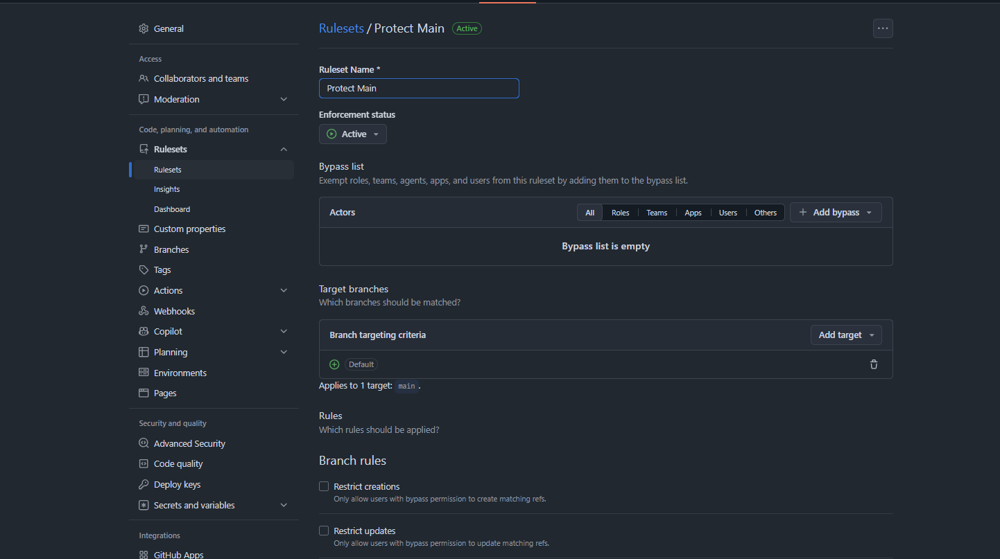
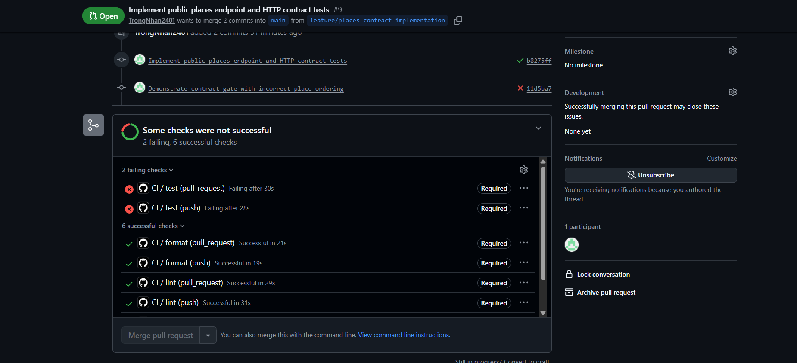
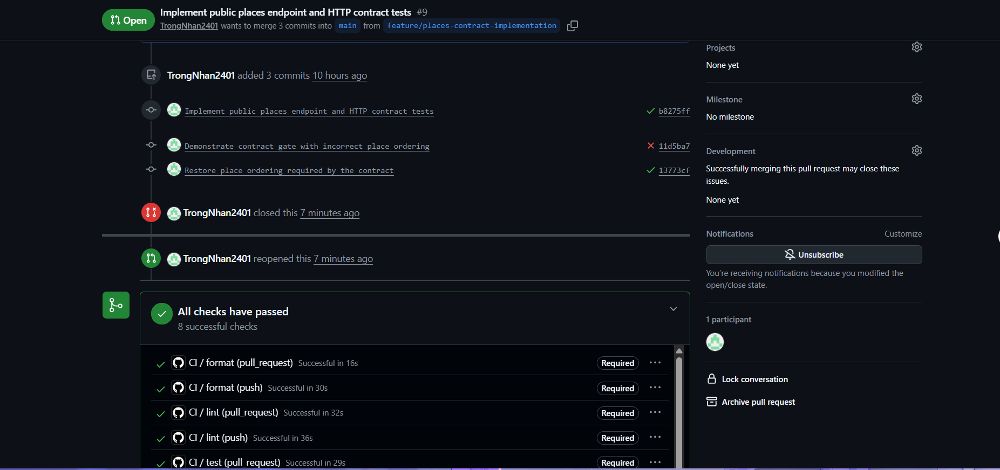
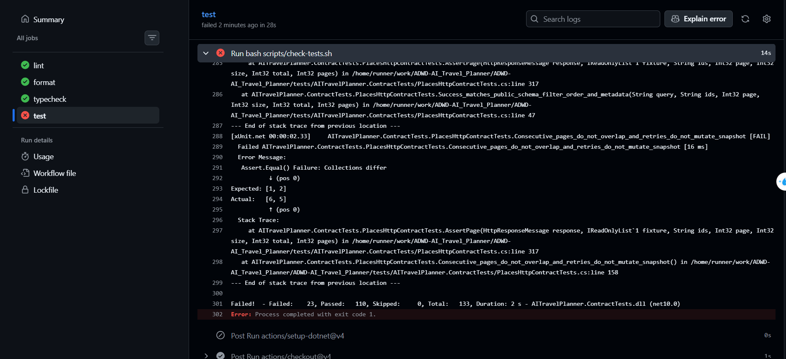

PA#2 — Evidence Index
Project: AI Travel Planner Course: CSC13114 — Class 23KTPM1 Team members:

23127325 - Lê Gia Bảo
23127443 - Trần Phạm Trọng Nhân

## 1. Repository
GitHub repository: https://github.com/ADWD-AI-Travel-Team/ADWD-AI_Travel_Planner
Default branch: main
## 2. Protected Branch Settings

The repository has an active ruleset named **Protect Main**, targeting the `main` branch. The bypass list is empty, so no roles, teams, apps, or users are explicitly exempted by this ruleset.

The ruleset protects `main` with these enabled branch rules:

- Restrict deletions.
- Require pull requests before merging.
- Require status checks to pass before changes are merged.
- Block force pushes.

## 3. Pull Request Blocked by CI

[PR #9](https://github.com/ADWD-AI-Travel-Team/ADWD-AI_Travel_Planner/pull/9)
was blocked after intentional implementation violation
[11d5ba7](https://github.com/ADWD-AI-Travel-Team/ADWD-AI_Travel_Planner/commit/11d5ba76d260a4a067610a5ff2a749982d0f6be1).
The required `test` check failed in
[the red pull-request run](https://github.com/ADWD-AI-Travel-Team/ADWD-AI_Travel_Planner/actions/runs/45646715518).
The screenshot shows the failed check marked Required and a disabled merge
button; this evidence is stronger than a red CI badge alone.

## 4. Pull Request Turned Green

On the same PR, fixing commit
[13773cf](https://github.com/ADWD-AI-Travel-Team/ADWD-AI_Travel_Planner/commit/13773cf2800d37fc72a440d56054ae100b5841b4)
restored the contract's ascending sort. All four jobs passed in
[green pull-request run 45733073631](https://github.com/ADWD-AI-Travel-Team/ADWD-AI_Travel_Planner/actions/runs/45733073631).
PR #9 was then merged via
[90862b1](https://github.com/ADWD-AI-Travel-Team/ADWD-AI_Travel_Planner/commit/90862b1fadb979cc76da4a8a7c45da9451adaee6),
preserving the baseline, violating and fixing commits.

## 5. CI Run for Submission Tag

Pending: no verified submission-tag run is supplied by this evidence task.
The current workflow triggers pushes to main/feature branches and PRs targeting
main, not tag pushes. A branch or PR run must not be labeled as a tag-triggered
run. The team must resolve the tag CI requirement and add a real run link
before claiming this evidence is complete. No tag was created or pushed here.

## 6. Deliberate Contract Break

The approved [GET /places contract](docs/contract/get-places.md) requires numeric
ID ascending order. The deliberate one-line implementation change replaced
`OrderBy` with `OrderByDescending` in
[ListPlaces.cs](src/Application/Places/ListPlaces.cs). The contract, architecture
tests and HTTP assertions were not changed to accommodate it.

[HTTP contract tests](tests/AITravelPlanner.ContractTests/PlacesHttpContractTests.cs)
detected the incorrect order. The captured pagination case expected `[1,2]`
and received `[6,5]`. The red test project reported 23 failures and 110 passes
out of 133 cases, with exit code 1. The separate numeric-sort case also failed
locally with expected `[1,2,10]`, actual `[10,2,1]`.

- [Correct baseline b8275ff](https://github.com/ADWD-AI-Travel-Team/ADWD-AI_Travel_Planner/commit/b8275ff3fce145fec6d437f72b4cb64bb38ecafd)
- [Baseline green pull-request CI](https://github.com/ADWD-AI-Travel-Team/ADWD-AI_Travel_Planner/actions/runs/45637930466)
- [Violating commit 11d5ba7](https://github.com/ADWD-AI-Travel-Team/ADWD-AI_Travel_Planner/commit/11d5ba76d260a4a067610a5ff2a749982d0f6be1)
- [Red push CI](https://github.com/ADWD-AI-Travel-Team/ADWD-AI_Travel_Planner/actions/runs/45646699706)
- [Fixing commit 13773cf](https://github.com/ADWD-AI-Travel-Team/ADWD-AI_Travel_Planner/commit/13773cf2800d37fc72a440d56054ae100b5841b4)
- [Fix green pull-request CI](https://github.com/ADWD-AI-Travel-Team/ADWD-AI_Travel_Planner/actions/runs/45733073631)
- [Complete evidence index and historical synchronization notes](docs/evidence/pa2-contract-gate.md)
- [Evidence publication PR #13](https://github.com/ADWD-AI-Travel-Team/ADWD-AI_Travel_Planner/pull/13)

The correct implementation passed 137 tests locally: 4 architecture cases plus
133 cases in the new project. The public catalog has no per-user ownership;
the HTTP suite checks anonymous access, strict validation, eligibility, paging,
success bodies/headers and both documented error types.
