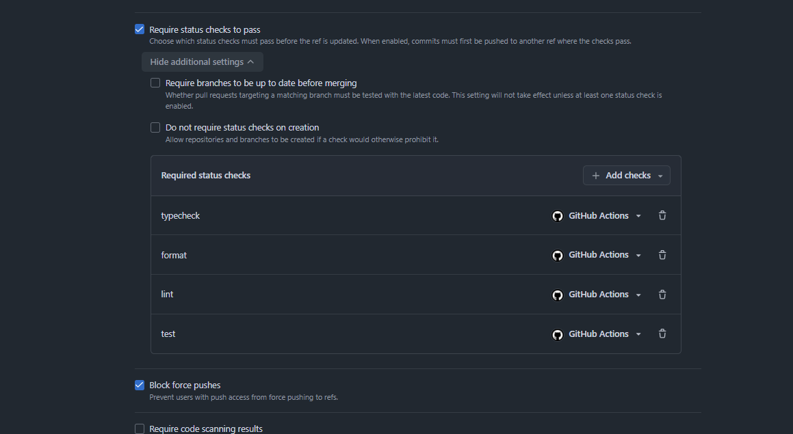

# PA#2 — Evidence Index
Project: AI Travel Planner Course: CSC13114 — Class 23KTPM1 Team members:

23127325 - Lê Gia Bảo
23127443 - Trần Phạm Trọng Nhân

## 1. Repository
GitHub repository: https://github.com/ADWD-AI-Travel-Team/ADWD-AI_Travel_Planner
Default branch: main
## 2. Protected Branch Settings

The repository has an active ruleset named **Protect Main**, targeting the `main` branch. The bypass list is empty, so no roles, teams, apps, or users are explicitly exempted by this ruleset.

The ruleset protects `main` with these enabled branch rules:

- Restrict deletions.
- Require pull requests before merging.
- Require status checks to pass before changes are merged.
- Block force pushes.

## 3. Pull Request Blocked by CI

[PR #9](https://github.com/ADWD-AI-Travel-Team/ADWD-AI_Travel_Planner/pull/9)
was blocked after intentional implementation violation
[11d5ba7](https://github.com/ADWD-AI-Travel-Team/ADWD-AI_Travel_Planner/commit/11d5ba76d260a4a067610a5ff2a749982d0f6be1).
The required `test` check failed in
[the red pull-request run](https://github.com/ADWD-AI-Travel-Team/ADWD-AI_Travel_Planner/actions/runs/45646715518).
The screenshot shows the failed check marked Required and a disabled merge
button; this evidence is stronger than a red CI badge alone.

## 4. Pull Request Turned Green

On the same PR, fixing commit
[13773cf](https://github.com/ADWD-AI-Travel-Team/ADWD-AI_Travel_Planner/commit/13773cf2800d37fc72a440d56054ae100b5841b4)
restored the contract's ascending sort. All four jobs passed in
[green pull-request run 45733073631](https://github.com/ADWD-AI-Travel-Team/ADWD-AI_Travel_Planner/actions/runs/45733073631).
PR #9 was then merged via
[90862b1](https://github.com/ADWD-AI-Travel-Team/ADWD-AI_Travel_Planner/commit/90862b1fadb979cc76da4a8a7c45da9451adaee6),
preserving the baseline, violating and fixing commits.

## 5. CI Run for Submission Tag

Submission tag: **`pa2`**. The exact-tag push trigger was merged in
[PR #15](https://github.com/ADWD-AI-Travel-Team/ADWD-AI_Travel_Planner/pull/15).
The same four scripts run against the tagged revision.

**Status at this documentation revision: the final tag has not been published
or its run verified.** This is the remaining external submission action, not
an already successful check.

[Find the pa2 tag's CI runs](https://github.com/ADWD-AI-Travel-Team/ADWD-AI_Travel_Planner/actions/workflows/ci.yml?query=branch%3Apa2).
This is a stable lookup link prepared before tagging, not a fabricated run ID
or a claim that a run already exists. After the human pushes the final tag,
verify its run is for ref `pa2`, the tagged commit matches, and all four jobs
pass. Save the actual run URL and screenshot with the hand-in evidence.

A commit cannot contain the run ID generated later by pushing its own tag.
Keep the final tag immutable: do not move/delete/recreate it just to insert a
future run URL. Record the resolved URL in the submission notes or an English
GitHub Release body attached to the same tag; neither requires moving the tag.
A later documentation PR may also record it on main, clearly outside the tagged
snapshot. See [the finalization procedure](docs/evidence/pa2-submission-finalization.md).
No tag creation/push or successful tag run is claimed here.

## 6. Deliberate Contract Break

The approved [GET /places contract](docs/contract/get-places.md) requires numeric
ID ascending order. The deliberate one-line implementation change replaced
`OrderBy` with `OrderByDescending` in
[ListPlaces.cs](src/Application/Places/ListPlaces.cs). The contract, architecture
tests and HTTP assertions were not changed to accommodate it.

[HTTP contract tests](tests/AITravelPlanner.ContractTests/PlacesHttpContractTests.cs)
detected the incorrect order. The captured pagination case expected `[1,2]`
and received `[6,5]`. The red test project reported 23 failures and 110 passes
out of 133 cases, with exit code 1. The separate numeric-sort case also failed
locally with expected `[1,2,10]`, actual `[10,2,1]`.

- [Correct baseline b8275ff](https://github.com/ADWD-AI-Travel-Team/ADWD-AI_Travel_Planner/commit/b8275ff3fce145fec6d437f72b4cb64bb38ecafd)
- [Baseline green pull-request CI](https://github.com/ADWD-AI-Travel-Team/ADWD-AI_Travel_Planner/actions/runs/45637930466)
- [Violating commit 11d5ba7](https://github.com/ADWD-AI-Travel-Team/ADWD-AI_Travel_Planner/commit/11d5ba76d260a4a067610a5ff2a749982d0f6be1)
- [Red push CI](https://github.com/ADWD-AI-Travel-Team/ADWD-AI_Travel_Planner/actions/runs/45646699706)
- [Fixing commit 13773cf](https://github.com/ADWD-AI-Travel-Team/ADWD-AI_Travel_Planner/commit/13773cf2800d37fc72a440d56054ae100b5841b4)
- [Fix green pull-request CI](https://github.com/ADWD-AI-Travel-Team/ADWD-AI_Travel_Planner/actions/runs/45733073631)
- [Complete evidence index and historical synchronization notes](docs/evidence/pa2-contract-gate.md)
- [Evidence publication PR #13](https://github.com/ADWD-AI-Travel-Team/ADWD-AI_Travel_Planner/pull/13)

The correct implementation passed 137 tests locally: 4 architecture cases plus
133 cases in the new project. The public catalog has no per-user ownership;
the HTTP suite checks anonymous access, strict validation, eligibility, paging,
success bodies/headers and both documented error types.

## 7. Remaining human review

- Confirm the self-assessment marks against evidence; the total 94/100 is the
  team's claim, not an independently awarded mark.
- The AI log's 2026-11-26 human review addendum records the user's contract
  corrections and check-parity feedback. Other manual changes/rejections have
  not been reported. Historical TODO(human) fields are preserved rather than
  silently rewritten; no additional feedback is invented to fill them.
- Confirm provider spending-cap evidence, secret-history review and rules-file
  traceability before claiming full credit for those criteria. The current
  endpoint and tests make no real model calls.
- Finish section 5's actual tag-run verification and hand-in packaging.
