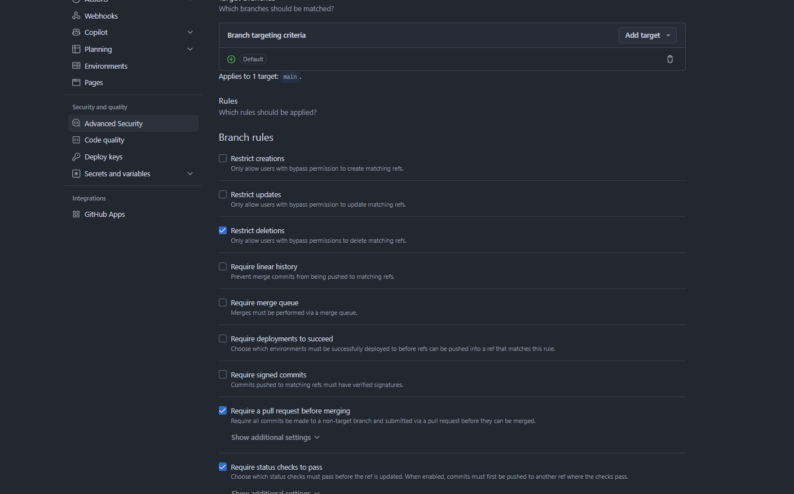
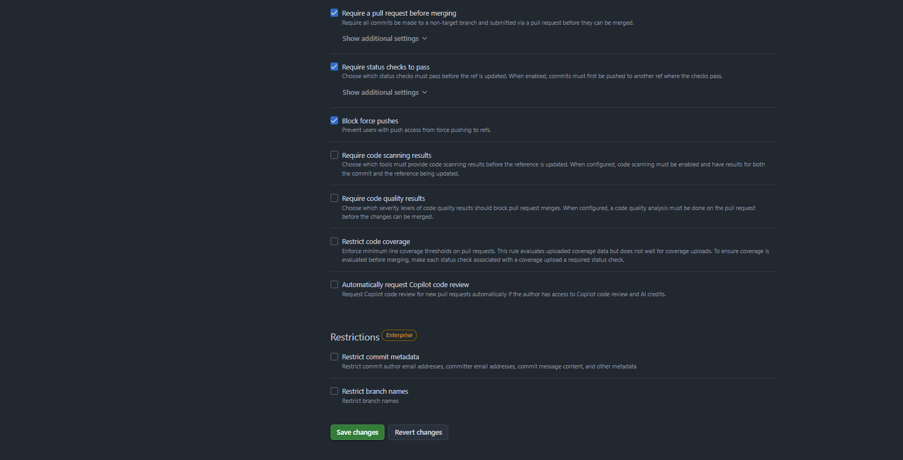

PA#2 — Evidence Index
Project: AI Travel Planner Course: CSC13114 — Class 23KTPM1 Team members:

23127325 - Lê Gia Bảo
23127443 - Trần Phạm Trọng Nhân

1. Repository
GitHub repository: https://github.com/ADWD-AI-Travel-Team/ADWD-AI_Travel_Planner
Default branch: main
2. Protected Branch Settings

The repository has an active ruleset named **Protect Main**, targeting the `main` branch. The bypass list is empty, so no roles, teams, apps, or users are explicitly exempted by this ruleset.

The ruleset protects `main` with these enabled branch rules:

- Restrict deletions.
- Require pull requests before merging.
- Require status checks to pass before changes are merged.
- Block force pushes.

3. Pull Request Blocked by CI

4. Pull Request Turned Green

5. CI Run for Submission Tag

6. Deliberate Contract Break