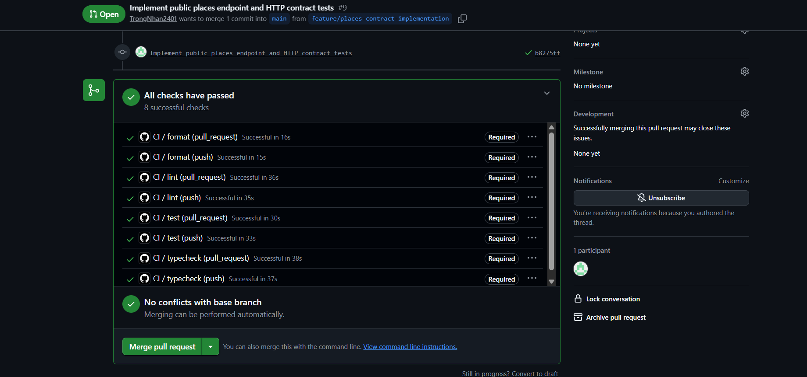
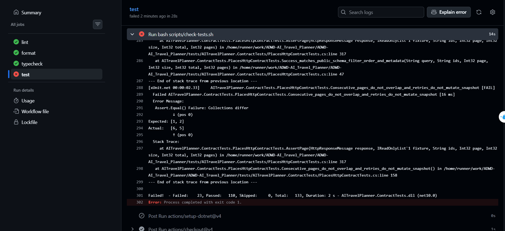
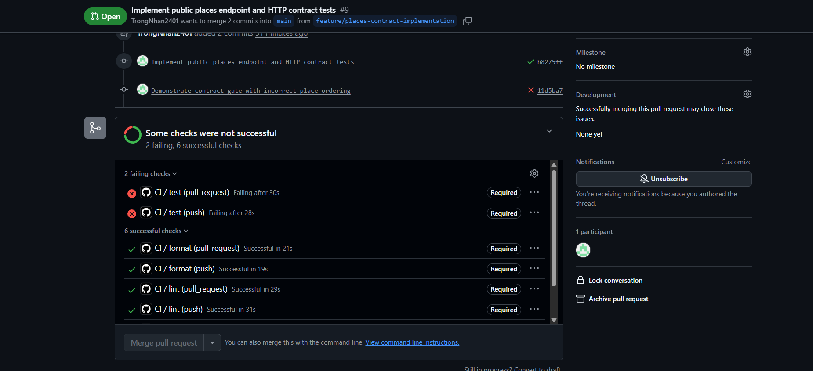
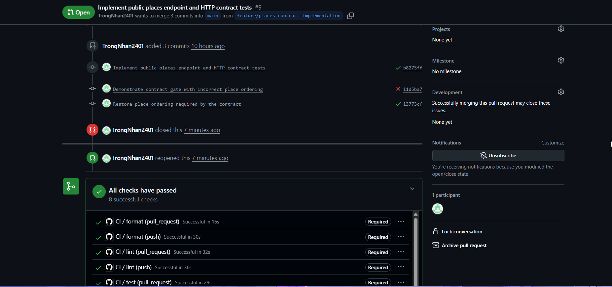

# PA#2 HTTP contract gate evidence

This index records observed evidence. PR #9 was verified merged on 2026-11-26;
the historical synchronization delay and its recovery are documented below.

| Evidence | Recorded value |
| --- | --- |
| Endpoint contract | [GET /places](../contract/get-places.md) |
| HTTP contract tests | [PlacesHttpContractTests.cs](../../tests/AITravelPlanner.ContractTests/PlacesHttpContractTests.cs) |
| Pull request | [PR #9](https://github.com/ADWD-AI-Travel-Team/ADWD-AI_Travel_Planner/pull/9) |
| Correct implementation baseline | [b8275ff](https://github.com/ADWD-AI-Travel-Team/ADWD-AI_Travel_Planner/commit/b8275ff3fce145fec6d437f72b4cb64bb38ecafd) |
| Baseline green pull-request run | [45637930466](https://github.com/ADWD-AI-Travel-Team/ADWD-AI_Travel_Planner/actions/runs/45637930466) |
| Intentional implementation-only violation | [11d5ba7](https://github.com/ADWD-AI-Travel-Team/ADWD-AI_Travel_Planner/commit/11d5ba76d260a4a067610a5ff2a749982d0f6be1) |
| Red push run | [45646699706](https://github.com/ADWD-AI-Travel-Team/ADWD-AI_Travel_Planner/actions/runs/45646699706) |
| Red pull-request run | [45646715518](https://github.com/ADWD-AI-Travel-Team/ADWD-AI_Travel_Planner/actions/runs/45646715518) |
| Failing test job | [139319509892](https://github.com/ADWD-AI-Travel-Team/ADWD-AI_Travel_Planner/actions/runs/45646699706/job/139319509892) |
| Implementation-only fixing commit | [13773cf](https://github.com/ADWD-AI-Travel-Team/ADWD-AI_Travel_Planner/commit/13773cf2800d37fc72a440d56054ae100b5841b4) |
| Green fixing-commit push run | [45649066961](https://github.com/ADWD-AI-Travel-Team/ADWD-AI_Travel_Planner/actions/runs/45649066961) |
| Green fixing-commit pull-request run | [45733073631](https://github.com/ADWD-AI-Travel-Team/ADWD-AI_Travel_Planner/actions/runs/45733073631) |
| Verified PR merge commit | [90862b1](https://github.com/ADWD-AI-Travel-Team/ADWD-AI_Travel_Planner/commit/90862b1fadb979cc76da4a8a7c45da9451adaee6) |

## What the failure demonstrates

The deliberate change replaced numeric ascending OrderBy with descending
OrderByDescending in Application/Places/ListPlaces.cs. The HTTP test
Numeric_sort_and_changed_catalog_have_coherent_per_response_totals expected
[1,2,10] but received [10,2,1]. Contract and assertions stayed unchanged.
The fixing commit restores ascending order, rather than weakening expectations.

The correct local implementation passed all four quality checks, with 137
tests passing: four architecture cases and 133 cases in the new test project.
GitHub checks on fixing commit 13773cf separately reported lint, format,
typecheck and test success.

## Required-check and screenshot evidence

During the red stage, read-only GitHub API inspection confirmed test was a
required context in ruleset 28039538, the test job failed on 11d5ba7, and PR #9
had mergeable_state blocked. The human separately confirmed capturing the
required-check/blocked-merge UI. Red CI alone is not claimed as sufficient
proof of a blocked merge.

All four images below are present directly in `docs/evidence/` and were visually
inspected on 2026-11-26. The paths match their actual locations.

### Baseline green

PR #9 shows baseline b8275ff, eight successful push/pull_request checks and an
available merge button.

### HTTP test detects the violation

The screenshot shows the real HTTP pagination test
`Consecutive_pages_do_not_overlap_and_retries_do_not_mutate_snapshot` failing:
expected [1,2], actual [6,5]. The new test project reports 23 failed, 110 passed,
zero skipped, total 133, and process exit code 1. The separate numeric-order
case's [1,2,10] versus [10,2,1] failure was observed locally; this image is not
misidentified as that case.

### Required check prevents merging

PR #9 displays commit 11d5ba7, failed `test` checks marked Required, and a
disabled Merge pull request button. This screenshot supplements the API
verification; the evidence is not merely a red CI badge.

### Fix green on the same PR

The same PR displays baseline b8275ff, violation 11d5ba7 and fix 13773cf, followed
by All checks have passed after close/reopen recovered PR synchronization.

## Historical GitHub synchronization delay and recovery

On 2026-11-25 the feature ref was 13773cf and its push run was successful,
but PR #9 still reported head 11d5ba7 with mergeable_state unknown. GitHub Status
reported degraded Pull Requests, Actions and Webhooks. That was consistent with
delayed PR updates; the individual PR root cause was not independently proven.
After the human closed and reopened the same PR, the PR synchronized and the
fixing-commit pull_request run 45733073631 passed all four jobs. The incident
is historical, not a claim of a currently pending synchronization problem.

## Integration with the team's submission documents

Read-only API verification confirmed PR #9 merged with fixing head 13773cf and
merge commit 90862b1fadb979cc76da4a8a7c45da9451adaee6 at
2026-11-26T01:15:55Z (08:15:55 in Vietnam). The human performed the merge.
The screenshots and this evidence/log update still need publication through a
separate human-controlled documentation PR. They were not part of the merged
implementation PR.

Teammate documentation has already reached main. PA2.md still has empty
sections for the blocked PR, green fix and deliberate break. After integrating
main through the human Git workflow, use the real links above to complete those
sections and link the actual screenshots. The current submission-tag run is
not supplied by this task and must remain pending until a real tag run exists.

SELF_ASSESSMENT_REPORT.md should reflect the evidence actually present at the
submission revision. Do not rewrite history, bypass required checks, silently
claim a stalled PR merged, or manufacture a tag/run/score justification.
